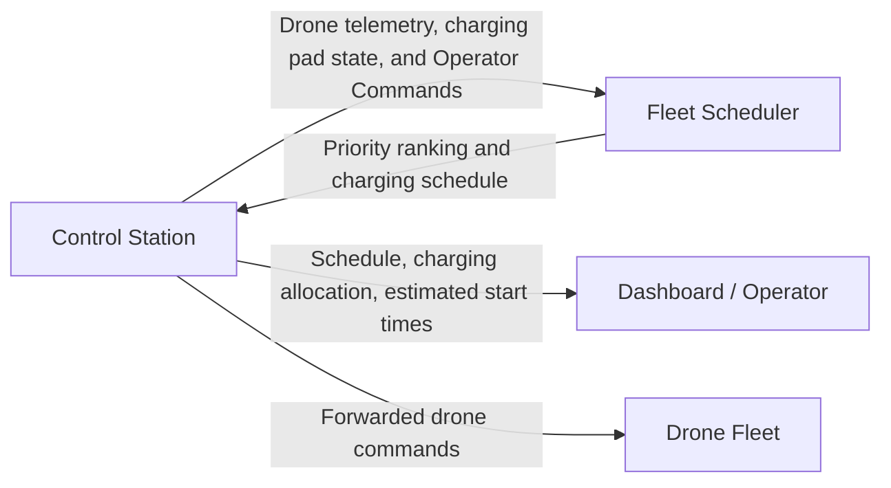

# Fleet Scheduler

## Table of Contents
* [Purpose](#purpose)
* [Requirements](#requirements)
* [Design](#design)

# Purpose

## Context

A fleet of 5–6 autonomous drones shares a single wireless charging pad, with each drone having different battery characteristics, energy consumption rates, and operational requirements.

## Problem

The limited charging resource must be allocated to competing drones while ensuring each can safely return to the pad and resume its mission.

## Solution

The Fleet Scheduler uses real-time drone telemetry and charging pad status to prioritize drones and dynamically allocate charging opportunities, balancing safety and fleet efficiency.

# Requirements

## Functional

### FR-006
The fleet scheduler SHALL receive event-driven drone state change notifications.

## Non-Functional

### NFR-001	
The fleet scheduler SHALL manage charging requests from multiple drones sharing a single charging pad.

### NFR-002	
The fleet scheduler SHALL consider the battery State of Charge (SoC) when allocating charging windows.

### NFR-003	
The fleet scheduler SHALL consider the battery State of Health (SoH) when allocating charging windows.

### NFR-004
The fleet scheduler SHALL consider each drone’s estimated energy consumption rate when allocating charging windows.

### NFR-005
The fleet scheduler SHALL consider each drone’s estimated time to return when allocating charging windows.

### NFR-006
The fleet scheduler SHALL consider each drone’s estimated latest possible time to begin return when allocating charging windows.

### NFR-007	
The fleet scheduler SHALL consider the current state of each drone and the charging pad when allocating charging windows.

# Design

## Inputs and Outputs

| Input | Purpose |
| ----- | ------- |
| State of Charge (SoC) | Estimates the battery's remaining charge. |
| State of Health (SoH) | Accounts for battery degradation and reduced usable capacity. |
| Energy consumption rate | Estimates energy consumption during flight, hovering, and other operating states. |
| Time to return | Estimates how long the drone needs to reach the charging pad. |
| Latest possible return-start time | Defines the latest safe time to begin returning. |
| Current drone state | Identifies whether the drone is flying, returning, landing, charging, or ready to depart. |
| Charging pad state | Indicates whether the pad is available, occupied, reserved, or unavailable. |
| Operator Commands | Override the scheduling logic to prioritize the command form the human operator. |

## Control Station and Fleet Scheduler

## Alternatives Analysis

There are many algorithms designed for real-time applications. As is well know there is no one "best" algorithm, and the implementation dictates which is better suited than the rest.

The central challenge for our system is that the drone with the lowest SoC is not necessarily the drone that needs the pad first. A drone with a higher consumption rate, longer return time, or more restrictive deadline may be at greater risk.

The scheduler must therefore consider both energy safety and resource availability.

| Algorithm | Notes |
| --------- | ----- |
| First Come First Serve (FCFS) | etc |
| Earliest Deadline First (EDF) | etc |
| Least Slack Time (LST) | etc |
| Fixed-Priority Preemptive | etc |
| Less Laxity and Longer remaining Processing time (LLLP) | Dynamic Scheduling for Charging Electric Vehicles: A Priority Rule Y. Xu, F. Pan, and L. Tong, 2016. IEEE Transactions on Automatic Control, 61(12), 4094–4099. |

Evaluate: Implementation complexity, charging pad utilization, adaptability to new info, drone energy efficiency (Can drones receive partial charges when sufficient for the next mission?), drone stranded rate, fairness, 

### FCFS
 
Serves charging requests in the order they arrive. Advantages include simple implementation and low scheduling overhead. However it does not account for SoC, SoH, energy consumption, or deadlines. A low-urgency drone could occupy the pad while another drone approaches its safe return deadline.

### EDF

Priority given to the drone with the earliest approaching deadline. Its advantage is that it dynamically responds to changing deadlines, unfortunate an earlier deadline does not necessarily mean a drone has the least energy reserve. It also does not inherently account for charging duration, landing time, or whether the pad will be available in time.

### LSTF

Algorithm prioritizes the drone with the least remaining scheduling flexibility, also called laxity.

A basic definition is:
Slack_i = D_i - t - C_i

Where D_i is the relevant deadline, t is the current time and C_i is the estimated time needed to complete the relevant task.

For this system, the task might include returning to the pad, landing, or waiting for access to the pad. The calculation must match the particular deadline being protected. The advantages here are that it accounts for both deadlines and remaining time requirements, can respond dynamically to changing return times and resource availability, and it also helps identify drones with little time left before missing a deadline.
On the either side however, it requires reliable estimates of task duration and pad availability, priorities may change frequently as estimates and telemetry update and a low-slack drone may still be infeasible to serve safely; the scheduler needs a separate feasibility and emergency-response check.

### Fixed-Priority Preemptive

This is where priority levels are assigned in advance and a higher-priority request can preempt lower-priority work under the policy's rules. It is a predictable priority structure, supports explicit emergency and mission-critical priorities and is useful for distinguishing emergency returns from routine charging requests. It's disadvantages are that static priorities may not reflect changing battery conditions, lower-priority drones can starve, and preempting a charging session is not necessarily physically practical or desirable.

### LLLP

This algorithm is a charging-related priority policy that combines slack/laxity with remaining processing time. Pros include the fact its design is directly relevant to resource scheduling with deadlines and differing charging requirements, and it encourages consideration of both urgency and the time needed to serve a request. Unfortunately, its theoretical guarantees depend on the model and objective being studied, and it may require additional calculations and assumptions compared with EDF or LSTF.