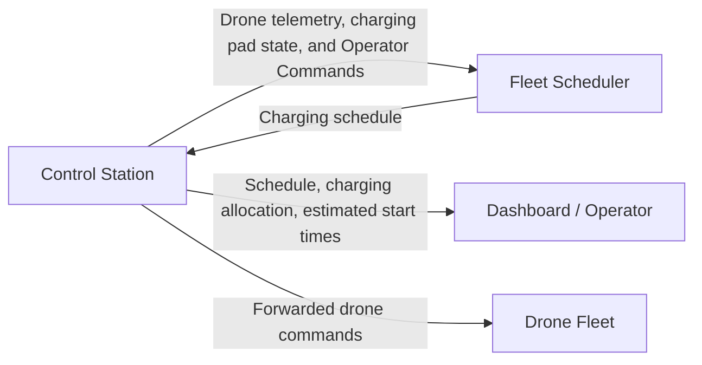
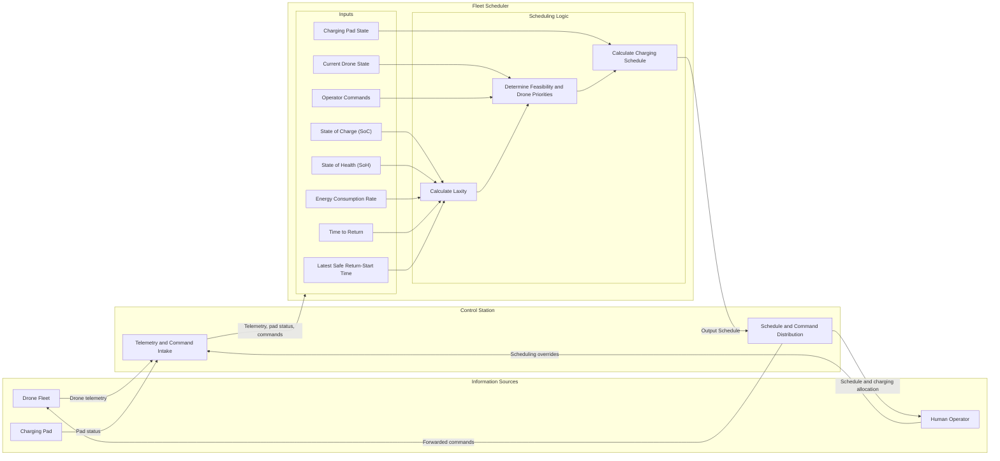

# Fleet Scheduler

## Table of Contents
* [Purpose](#purpose)
  * [Context](#context)
  * [Problem](#problem)
  * [Solution](#solution)
* [Requirements](#requirements)
  * [Functional](#functional)
  * [Non-Functional](#non-functional)
* [Design](#design)
  * [Inputs and Outputs](#inputs-and-outputs)
  * [Alternatives Analysis](#alternatives-analysis)

# Purpose

## Context

A fleet of 5–6 autonomous drones shares a single wireless charging pad, with each drone having different battery characteristics, energy consumption rates, and operational requirements.

## Problem

The limited charging resource must be allocated to competing drones while ensuring each can safely return to the pad and resume its mission.

## Solution

The Fleet Scheduler uses real-time drone telemetry and charging pad status to prioritize drones and dynamically allocate charging opportunities, balancing safety and fleet efficiency.

# Requirements

## Functional

### FR-006
The fleet scheduler SHALL receive event-driven drone state change notifications.

## Non-Functional

### NFR-001
The fleet scheduler SHALL manage charging requests from multiple drones sharing a single charging pad.

### NFR-002
The fleet scheduler SHALL consider the battery State of Charge (SoC) when allocating charging windows.

### NFR-003
The fleet scheduler SHALL consider the battery State of Health (SoH) when allocating charging windows.

### NFR-004
The fleet scheduler SHALL consider each drone’s estimated energy consumption rate when allocating charging windows.

### NFR-005
The fleet scheduler SHALL consider each drone’s estimated time to return when allocating charging windows.

### NFR-006
The fleet scheduler SHALL consider each drone’s estimated latest possible time to begin return when allocating charging windows.

### NFR-007
The fleet scheduler SHALL consider the current state of each drone and the charging pad when allocating charging windows.

# Design

## Inputs and Outputs

This section defines the relationship between the Fleet Scheduler and the Control Station. The sources of information (charging pad, drone fleet, and operator) all filter through the control station to provide the input to the scheduler. The scheduler then send the resulting charging allocations back to the station for it to forward to the relevant drones.

The inputs are as follows:

| Input | Purpose |
| ----- | ------- |
| State of Charge (SoC) | Estimates the battery's remaining charge. |
| State of Health (SoH) | Accounts for battery degradation and reduced usable capacity. |
| Energy consumption rate | Estimates energy consumption during flight, hovering, and other operating states. |
| Time to return | Estimates how long the drone needs to reach the charging pad. |
| Latest possible return-start time | Defines the latest safe time to begin returning. |
| Current drone state | Identifies whether the drone is flying, returning, landing, charging, or ready to depart. |
| Charging pad state | Indicates whether the pad is available, occupied, reserved, or unavailable. |
| Operator Commands | Override the scheduling logic to prioritize the command form the human operator. |

Visually, the high-level overview is as shown:

## Alternatives Analysis

There are many algorithms designed for real-time applications. As is well know there is no one "best" algorithm, and the implementation dictates which is better suited than the rest.

The central challenge for our system is that the drone with the lowest SoC is not necessarily the drone that needs the pad first. A drone with a higher consumption rate, longer return time, or more restrictive deadline may be at greater risk.

The scheduler must therefore consider both energy safety and resource availability.

### Algorithm Basis

| Algorithm | Notes |
| --------- | ----- |
| First Come First Serve (FCFS) | N/A |
| Fixed-Priority Preemptive | N/A |
| Earliest Deadline First (EDF) | N/A |
| Least Laxity First (LLF) | N/A |
| Less Laxity and Longer remaining Processing time (LLLP) | Dynamic Scheduling for Charging Electric Vehicles: A Priority Rule Y. Xu, F. Pan, and L. Tong, 2016. IEEE Transactions on Automatic Control, 61(12), 4094–4099. |

#### FCFS

Also referred to as FIFO (First Come First Serve), this algorithm would serve charging requests in the order they arrive. Advantages include extremely simple implementation and low scheduling overhead. However it does not account for SoC, SoH, energy consumption, or deadlines. A low-urgency drone could occupy the pad while another drone approaches its safe return deadline.

#### Fixed-Priority Preemptive

This is where priority levels are assigned in advance and a higher-priority request can preempt lower-priority work under the policy's rules. It is a predictable priority structure, supports explicit emergency and mission-critical priorities and is useful for distinguishing emergency returns from routine charging requests. It's disadvantages are that static priorities may not reflect changing battery conditions, lower-priority drones can starve, and preempting a charging session is not necessarily physically practical or desirable.

#### EDF

Here, priority will be given to the drone with the earliest approaching deadline. This algorithm is known to be optimal for single resource scheduling as it dynamically responds to changing deadlines, unfortunately in this case, an earlier deadline does not necessarily mean a drone has the least energy reserve.

#### LLF

This is another algorithm that is considered optimal for single resource scheduling. Here, the drone with the least remaining scheduling flexibility, also called laxity, has priority.

Laxity is:
L_i = D_i - t - C_i

Where D_i is the relevant deadline, t is the current time and C_i is the estimated time needed to complete the relevant task.

For this system, the task might include returning to the pad, landing, or waiting for access to the pad. The calculation must match the particular deadline being protected. The advantages here are that it accounts for both deadlines and remaining time requirements, can respond dynamically to changing return times and resource availability, and it also helps identify drones with little time left before missing a deadline (stranded).
On the other side however, it requires reliable estimates of task duration and pad availability, priorities may change frequently as estimates and telemetry update and a low-slack drone may still be infeasible to serve safely.

#### LLLP

This algorithm, proposed by Xu et al., is based on the fact that when the completion of all tasks is not feasible, it has been demonstrated that EDF and LLF may perform poorly. Their algorithm is a charging-related priority policy that combines laxity with remaining processing time. Pros include the fact its design is directly relevant to resource scheduling with deadlines and differing charging requirements, and it encourages consideration of both urgency and the time needed to serve a request. Unfortunately, its theoretical guarantees depend on their specific model and objective being studied, and it may require additional calculations and assumptions compared with EDF or LLF.

### Weighted Evaluation

| Parameter | Weight | FCFS | Fixed-Prio | EDF | LLF | LLLP |
| --------- | ----- | ----- | ----- | ----- | ----- | ----- |
| 1. Energy Safety | 30% | 3 | 7 | 6 | 8 | 8 |
| 2. Adaptability | 20% | 2 | 4 | 8 | 9 | 8 |
| 3. Charging Efficiency | 15% | 4 | 5 | 7 | 7 | 8 |
| 4. Charging Pad Utilization | 15% | 6 | 6 | 8 | 7 | 8 |
| 5. Implementation Complexity | 10% | 10 | 7 | 8 | 6 | 4 |
| 6. Fairness | 10% | 8	| 4 | 6 | 5 | 5 |
| FInal Score | | 4.55 | 5.65 | 7.15 | 7.35 | 7.20 |

Elaboration on Parameters:
1. Ability to incorporate battery state, energy consumption, and safe return requirements to minimize stranded drones.
2. Ability to recalculate priorities when telemetry, drone states, or pad availability change.
3. Ability to allocate charging time effectively, including partial charging when sufficient for the next mission.
4. Ability to minimize idle time and coordinate access to the single charging pad.
5. Effort required to adapt the algorithm to the system's requirements and integrate it with the Fleet Scheduler.
6. Ability to prevent drones from being indefinitely delayed while accommodating urgent charging needs.

## Interface Design

Laxity is calculated by:

L_i = D_i - t - C_i

Letting D_i be the deadline by which drone i must reach the charging pad and C_i be the estimated time drone i needs to return to the charging pad...

T_latest return start,i = D_i - C_i

L_i = T_latest return start,i - t_current

Revised usage of inputs:

| Input | Usage |
| ----- | ------- |
| State of Charge (SoC), State of Health (SoH) and Energy consumption rate | Estimates latest possible return-start time. |
| Latest possible return-start time | Used to calculate laxity. |
| Current time | Used to calculate laxity. |
| Time to return | Estimates arrival of drone and scheduling feasibility. |
| Current drone state | Determine whether the drone is flying, returning, landing, charging, or ready to depart. |
| Charging pad state | Determine pad availability. |
| Operator Commands | Scheduling overrides. |