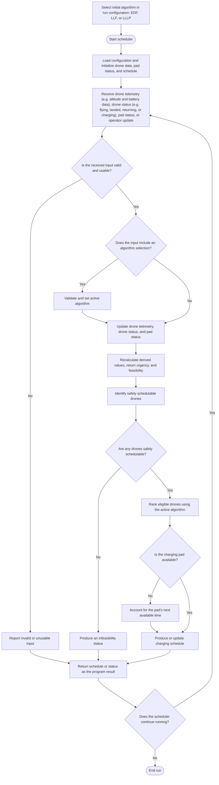

# Fleet Scheduler Program Workflow

## Remaining design decisions

- What input-update format and timing the Control Station provides.
- How charging duration and the pad's next available time are estimated.
- How telemetry validity and staleness are determined.
- Which operator data or overrides are part of the scheduler's input, and how they interact with safety and feasibility checks.
- Whether a new schedule replaces only waiting/future assignments or can alter an assignment already underway. A conservative initial policy is to leave charging already in progress unchanged and apply recalculation to future assignments.
- What criteria define the best-performing algorithm for the demo.
